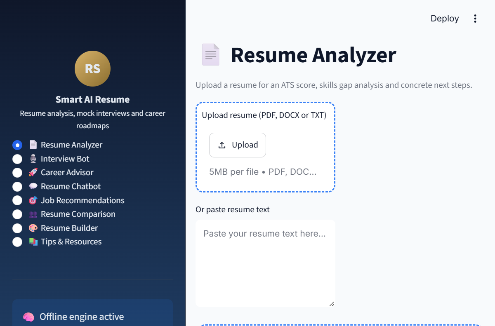
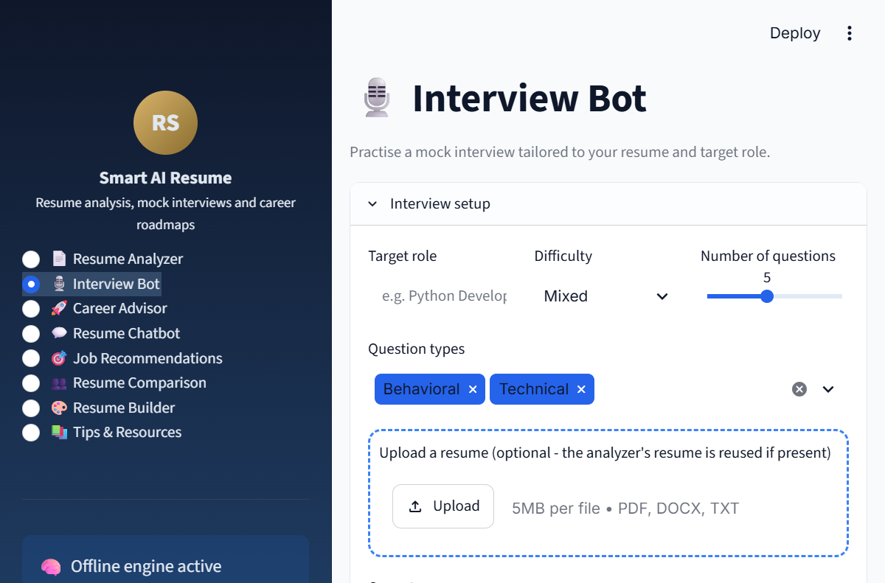
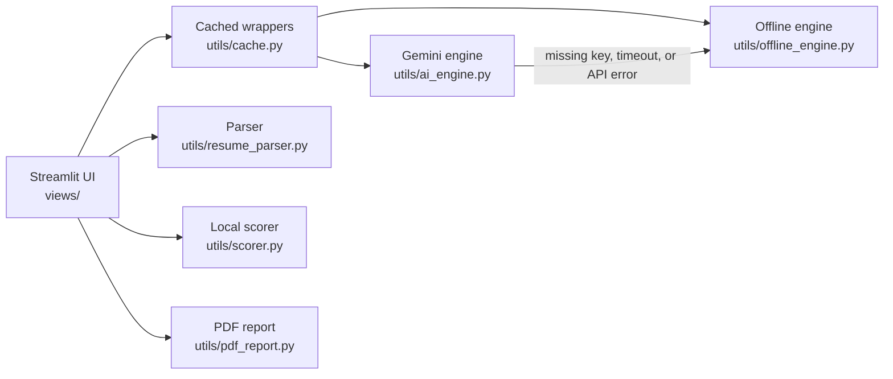

<div align="center">

# Smart AI Resume Analyzer

**An eight-module career toolkit that scores your resume, matches it to a job description, runs mock interviews, and builds a learning roadmap - with or without an API key.**

[](https://smart-ai-resume-analyzer-nfdlpabrwsiiuvghfphuzv.streamlit.app/)
[](https://rishabh71206.github.io/rishabh-srivastava-portfolio/)

[](https://www.python.org/)
[](https://streamlit.io/)
[](https://ai.google.dev/)
[](tests/)
[](LICENSE)

</div>



## Why this project

Most resume tools are thin wrappers around a language model. This one is built to keep working when the model is unavailable:

- **Gemini when available.** If `GEMINI_API_KEY` is set, feedback is written by Google Gemini using a model fallback list.
- **A real offline engine.** Every module - scoring, job matching, interview questions, answer evaluation, career advice, chat, job recommendations, comparison, and resume building - has a deterministic fallback.
- **Transparent results.** The UI labels each result as `Generated with Gemini` or `Offline analysis`, so you always know where the feedback came from.
- **Privacy first.** Uploaded files are parsed in memory for the current session. Offline mode makes no external requests.

## What is inside

| Module | What it does |
| --- | --- |
| **Resume Analyzer** | Overall, ATS, skills, and completeness scores; section radar; strengths, gaps, and prioritised edits; optional job-description match; downloadable PDF report. |
| **Interview Bot** | Generates role-specific behavioural, technical, situational, and HR questions, then scores your answers with STAR-style feedback and a model answer. |
| **Career Advisor** | Detects your current level, measures fit for a target role, lists skill gaps, and produces a five-step action plan with learning resources. |
| **Resume Chatbot** | Answers questions grounded in your resume: strongest skills, ATS improvements, best-fit roles, and missing experience. |
| **Job Recommendations** | Ranks five realistic role tracks against your current skills, with salary bands, hiring demand, and the exact skills to add. |
| **Resume Comparison** | Compares two candidates across overall, skills, experience, education, and presentation, then explains the winner. |
| **Resume Builder** | Collects your details and produces a clean, ATS-friendly Markdown resume ready to export. |
| **Tips & Resources** | A curated library of resume, LinkedIn, interview, and portfolio advice with practical checklists. |



## Quick start

### 1. Clone and install

```bash
git clone https://github.com/rishabh71206/smart-ai-resume-analyzer.git
cd smart-ai-resume-analyzer
python -m venv .venv

# Windows
.venv\Scripts\activate
# macOS / Linux
source .venv/bin/activate

pip install -r requirements.txt
```

### 2. Optional: add a Gemini key

The app works without a key. To enable Gemini-written feedback:

```bash
# Windows
Copy-Item .env.example .env
# macOS / Linux
cp .env.example .env
```

Then set `GEMINI_API_KEY` in `.env`. Get a free key from [Google AI Studio](https://aistudio.google.com/app/apikey).

### 3. Run

```bash
streamlit run app.py
```

Open <http://localhost:8501>. The sidebar shows whether Gemini or the offline engine is active.

## Configuration

| Variable | Default | Purpose |
| --- | --- | --- |
| `GEMINI_API_KEY` | empty | Enables Gemini. Empty means offline mode. |
| `GEMINI_MODEL` | `gemini-2.5-flash,gemini-2.0-flash,gemini-1.5-flash` | Comma-separated fallback list, tried in order. |
| `AI_TIMEOUT_SECONDS` | `60` | Per-request timeout. |
| `AI_MAX_RETRIES` | `2` | Retries per model before falling back. |

Values are read from environment variables first, then Streamlit secrets, then the defaults in [`config.py`](config.py). For Streamlit Cloud, add the same keys under **App settings -> Secrets**; see [`.streamlit/secrets.toml.example`](.streamlit/secrets.toml.example).

## How scoring works

The headline score is a transparent blend:

```text
overall = 0.60 * AI review + 0.25 * skills match + 0.15 * completeness
```

- **AI review** - Gemini's structured score, clamped to 0-100.
- **Skills match** - overlap between the skills found in the resume and the role's required skills (or the built-in catalogue when no job description is supplied).
- **Completeness** - presence and quality of summary, experience, education, skills, projects, and certifications.

The offline engine adds heuristics for stated years of experience, job titles, quantified impact, action verbs, contact details, keyword density, and ATS-friendly formatting. It is deliberately calibrated so a strong resume lands in the 70s-80s rather than a meaningless 100.

## Architecture



```text
.
├── app.py                    # Shell, theme, sidebar, routing
├── config.py                 # Environment / secrets / defaults
├── views/                    # The eight feature modules
│   ├── resume_analyzer.py
│   ├── interview_bot.py
│   ├── career_advisor.py
│   ├── chatbot.py
│   ├── job_recommendations.py
│   ├── resume_comparison.py
│   ├── resume_builder.py
│   └── tips_resources.py
├── utils/
│   ├── ai_engine.py          # Gemini + normalisers + fallback
│   ├── offline_engine.py     # Deterministic engine for every feature
│   ├── cache.py              # st.cache_data wrappers
│   ├── resume_parser.py      # PDF / DOCX / TXT extraction
│   ├── scorer.py             # Skills, completeness, weighted score
│   ├── pdf_report.py         # Downloadable PDF report
│   └── ui.py                 # Shared presentation helpers
├── tests/                    # 36 unit and integration tests
├── docs/                     # Screenshots and a sample resume
├── .streamlit/config.toml    # Theme and upload limit
└── .github/workflows/ci.yml  # Lint + tests on Python 3.11 and 3.12
```

## Quality checks

```bash
pip install -r requirements-dev.txt
ruff check .
pytest
```

The suite covers parsing, section detection, scoring, the offline engine, Gemini normalisers and fallback behaviour, and PDF generation. CI runs the same commands on every push and pull request.

## Deploy your own copy

1. Fork this repository.
2. On [Streamlit Community Cloud](https://share.streamlit.io/), create a new app pointing at your fork, branch `main`, main file `app.py`.
3. Optional: add `GEMINI_API_KEY` in **App settings -> Secrets**.
4. Deploy. `runtime.txt` pins Python 3.12, and `.streamlit/config.toml` sets the theme and 5 MB upload limit.

## Privacy

- Uploaded files are parsed in memory and kept in the Streamlit session only.
- Offline mode makes no external requests.
- If Gemini is enabled, the resume text and your questions are sent to Google's Gemini API under your key. Do not upload documents you are not allowed to share.
- No analytics, no database, no stored resumes.

## Contributing

Issues and pull requests are welcome. Please run `ruff check .` and `pytest` before opening a PR, and keep new features working in offline mode.

## License

MIT. See [LICENSE](LICENSE).

## Author

**Rishabh Srivastava** - Python developer building AI products and career-tech tools.

- GitHub: [@rishabh71206](https://github.com/rishabh71206)
- Portfolio: [rishabh71206.github.io/rishabh-srivastava-portfolio](https://rishabh71206.github.io/rishabh-srivastava-portfolio/)
- Email: [rishabhsrivastava712008@gmail.com](mailto:rishabhsrivastava712008@gmail.com)

If this project helped you, consider giving it a star.
